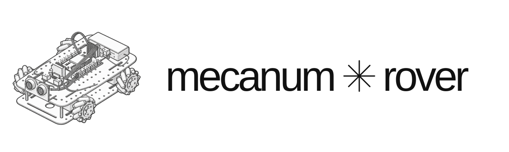

<div align="center">
  <p></p>
  <p><a href="https://mecanum-rover-website.vercel.app">Website</a> / <a href="https://github.com/PeterYuanCS/Mecanum_Rover_Code">OSS Code</a></p>
</div>

##  Prerequisites

Install Node.js 22 (version 22.13 or newer), which includes npm (the package manager).

##  Installation

From the repository root, install the dependencies and start the website:

```sh
npm ci
npm run dev
```

Open the local address shown in the terminal. The rover firmware is available in [Mecanum Rover Code](https://github.com/PeterYuanCS/Mecanum_Rover_Code).

Cheers,
