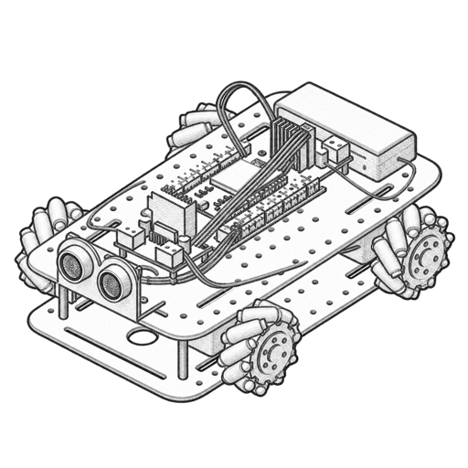

<div align="center">
  
  <h1>The Making of a Mecanum Rover</h1>
</div>

## About the project 

Here is the website showing the construction and proposed control of an ESP32-based mecanum rover. It covers the assembled
mechanical and electrical platform, four-wheel mecanum movement, ultrasonic distance measurement, and a proposed
reactive obstacle-avoidance method.

## Run the website

Requires Node.js 22.13 or newer.

```bash
npm install
npm run dev
```

Open the local address shown in the terminal.

This summer project has been supervised by Simon Provost.